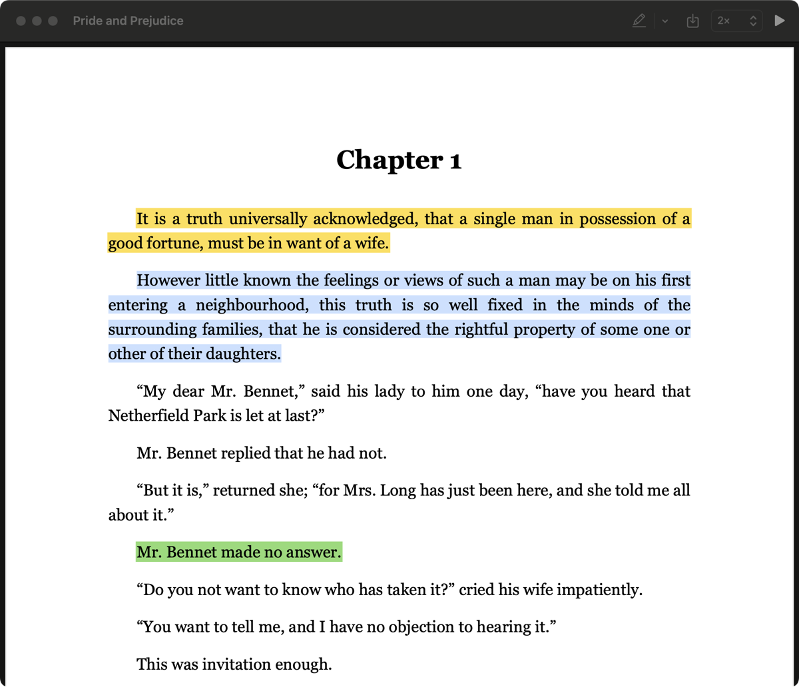
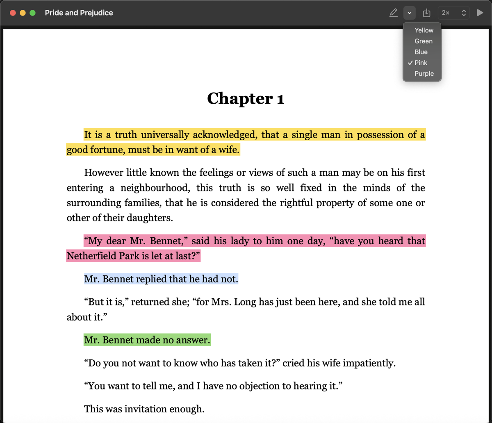

<p align="center"></p>

# ReadItOut

A Mac PDF reader that reads the book aloud while you follow along. The sentence being spoken is outlined on the page, and the page follows the voice. Everything runs offline on your Mac, using the [Kokoro](https://github.com/thewh1teagle/kokoro-onnx) neural voice "George".



## Features

1. Reads any text PDF aloud, continuously, from wherever you are.
2. Outlines the sentence being read and scrolls to keep it in view.
3. Speed from 0.75x to 2x.
4. Double-click any sentence to start reading from there.
5. Highlight as you listen in five colors. Highlights are saved inside the PDF, so Preview, iPhone and iPad show them too.
6. Remembers your place in each book.



## Install

Needs macOS 14 or later, the Xcode Command Line Tools, and Python 3.10 or later.

```bash
./setup.sh                # once: installs the voice (about 350 MB)
./build.sh                # builds build/ReadItOut.app
open build/ReadItOut.app
```

The voice lives in `~/Library/Application Support/ReadItOut`.

## Shortcuts

| Key | Action |
|---|---|
| Space | Play / pause |
| → / ← | Next / previous sentence |
| [ / ] | Slower / faster |
| H | Highlight the selection, or the sentence being read |
| Delete | Remove highlight |
| 1 to 5 | Yellow, green, blue, pink, purple |
| ⌘S | Save highlights into the PDF (also done when you quit) |
